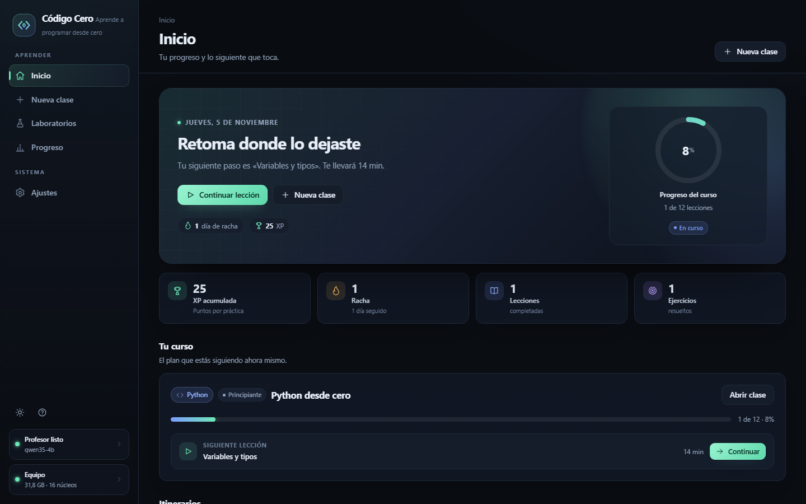
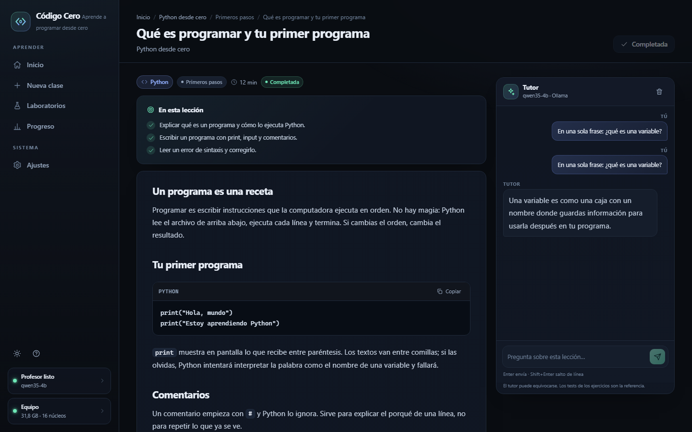
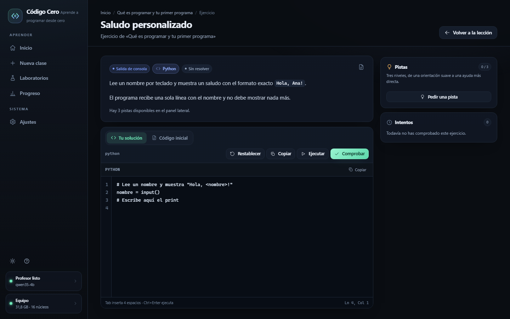
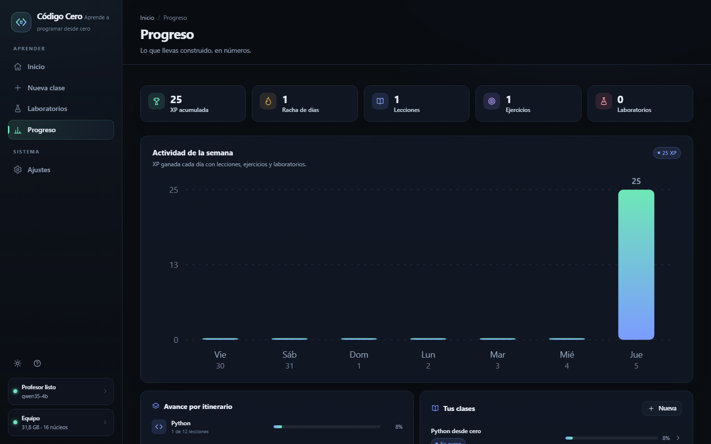
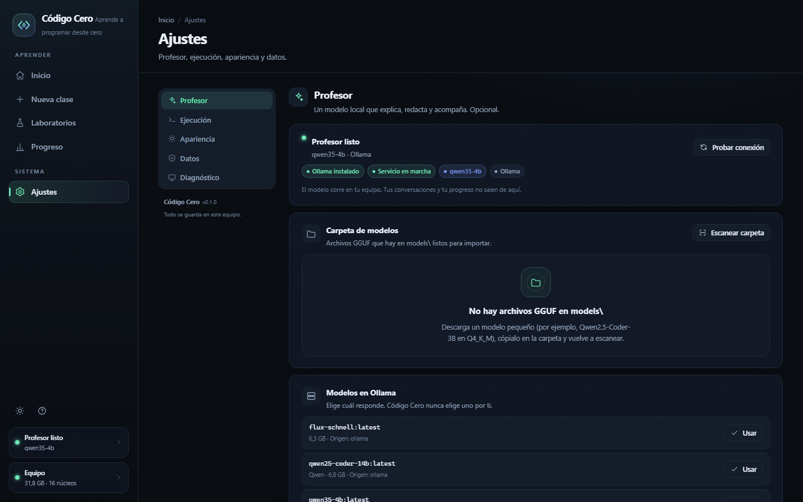
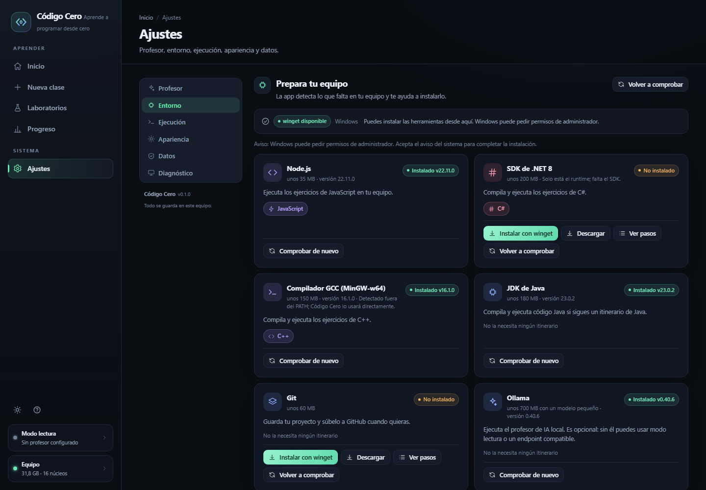
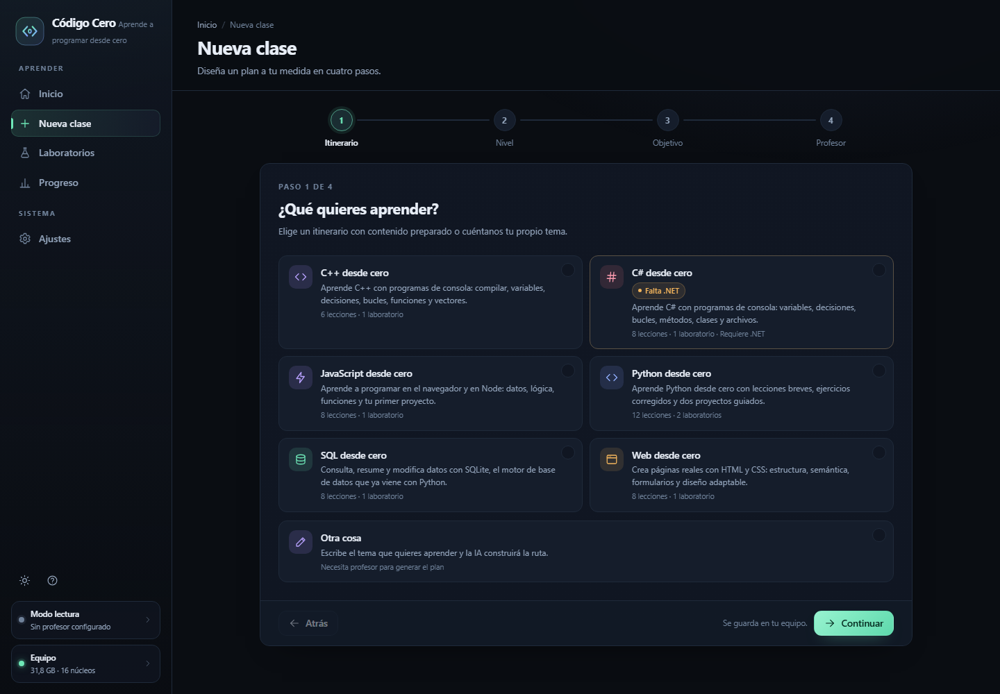

# Código Cero

**Aprende a programar con un profesor de IA que corre en tu propio equipo.**

Código Cero es una aplicación web local para aprender programación desde cero:
lecciones, ejercicios corregidos de verdad y laboratorios guiados. No hay cuentas,
no hay nube y no hace falta internet: todo vive en tu ordenador.



## Qué incluye

- **Seis itinerarios**: Python, Web (HTML y CSS), JavaScript, SQL, C# y C++.
- **Nueva clase con IA**: describes qué quieres aprender y genera una ruta con
  módulos y lecciones; o empiezas por una ruta ya preparada.
- **Lecciones** en Markdown con ejemplos, errores típicos y quiz.
- **Ejercicios** con editor, ejecución real y tests deterministas. El profesor
  explica, pero quien decide si está bien es el test.
- **Laboratorios**: proyectos por pasos con verificación en cada etapa.
- **Entorno**: detecta qué herramientas faltan (Node.js, .NET, GCC para C++,
  Java, Git u Ollama) y te guía para instalarlas con winget, la web oficial o
  pasos concretos. También encuentra herramientas instaladas fuera del PATH.
- **Profesor local**: cualquier modelo GGUF que descargues de Hugging Face, a
  través de Ollama. Sin modelo, la app funciona en modo lectura.
- **Progreso**: lecciones completadas, ejercicios resueltos, racha y XP.
- **Privado por diseño**: tu código y tus datos no salen del equipo.

## Capturas

| Lección con tutor | Ejercicios corregidos |
|---|---|
|  |  |

| Progreso | Profesor y modelos |
|---|---|
|  |  |

| Entorno y herramientas | Nueva clase |
|---|---|
|  |  |


## Requisitos

| Necesario | Detalle |
|---|---|
| Python 3.10 o superior | El proyecto no usa dependencias fuera de Flask |
| Un navegador moderno | Chrome o Edge recomendados (se abre en modo aplicación) |
| Ollama | Opcional, solo para el profesor de IA: https://ollama.com |
| Un modelo GGUF | Opcional, se descarga aparte (ver `models/README.md`) |

La app está pensada para equipos modestos: funciona bien en un portátil con
procesador i5 y 8–16 GB de RAM, sin tarjeta gráfica dedicada.

## Inicio rápido

```bash
git clone https://github.com/TU-USUARIO/codigo-cero.git
cd codigo-cero
python -m pip install -r requirements.txt
```

En Windows, haz doble clic en **`Iniciar.bat`**. En cualquier sistema:

```bash
python run.py
```

Se abrirá en `http://127.0.0.1:8765`. Si el puerto está ocupado, la app busca el
siguiente libre.

## Añadir un profesor

La app no incluye ningún modelo; el profesor lo eliges tú.

1. Descarga un GGUF pequeño de Hugging Face. Para empezar:
   [`Qwen2.5-Coder-3B-Instruct-GGUF`](https://huggingface.co/models?search=Qwen2.5-Coder-3B-Instruct-GGUF),
   cuantización `Q4_K_M`.
2. Copia el archivo (o todos sus trozos) en la carpeta **`models/`**.
3. Abre la app → **Ajustes → Profesor → Escanear carpeta**.
4. Pulsa **Añadir como profesor**: se importa a Ollama y queda listo.

Guía completa en [`models/README.md`](models/README.md).

| Modelo | Peso | RAM | Velocidad orientativa |
|---|---|---|---|
| Qwen2.5-Coder-1.5B | ~1,1 GB | ~2,5 GB | muy rápida |
| **Qwen2.5-Coder-3B** | ~2,0 GB | ~3,5 GB | recomendada |
| Qwen2.5-Coder-7B | ~4,7 GB | ~6,5 GB | lenta en CPU |

También puedes conectar un servidor compatible con OpenAI (LM Studio, llama.cpp,
vLLM) desde Ajustes, sin Ollama.

## Cómo funciona

```
Navegador  ──  Flask (127.0.0.1)  ──  SQLite (data/app.db)
                     │
                     ├──  Ollama / endpoint compatible (profesor)
                     └──  Ejecución local de código con límites
```

- Las lecciones y los ejercicios se guardan en SQLite; el contenido semilla está
  en `content/tracks/`.
- El código del alumno se ejecuta en una carpeta temporal, con tiempo máximo,
  límite de salida y sin permisos elevados.
- Los ejercicios se corrigen comparando la salida real con la esperada (o las
  filas de una consulta SQL). La IA nunca decide si un test pasa.
- Si no hay profesor configurado, todo lo demás sigue funcionando.

## Estructura del proyecto

```
app/            servidor, base de datos, IA, ejecución y evaluación
web/            interfaz (HTML, CSS y JavaScript sin dependencias)
content/tracks/ itinerarios y ejercicios semilla
models/         aquí van tus modelos .gguf (no se suben al repositorio)
docs/           especificación y capturas
tools/          validación y resumen del contenido
tests/          pruebas automáticas
```

## Desarrollo

```bash
python -m unittest discover -s tests -v   # pruebas
python tools/validate_content.py          # valida itinerarios y soluciones
python run.py --no-browser                # servidor sin abrir ventana
```

La integración continua se ejecuta en Windows y Linux con Python 3.10 y 3.12.

## Privacidad

No hay telemetría, ni cuentas, ni peticiones a servidores externos. El profesor
habla con Ollama en `127.0.0.1`; si usas otro endpoint, es el que tú configures.

## Licencia

MIT. Consulta [LICENSE](LICENSE).
